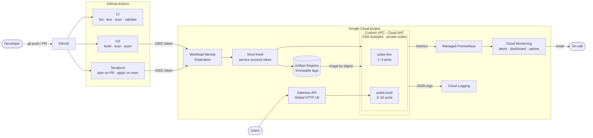
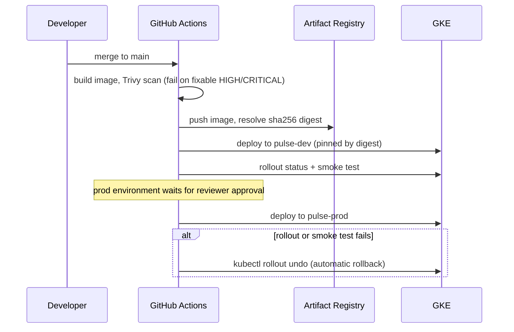

# GKE DevOps Platform

[](https://github.com/YOUR_USERNAME/gke-devops-platform/actions/workflows/ci.yml)
[](https://github.com/YOUR_USERNAME/gke-devops-platform/actions/workflows/cd.yml)
[](https://github.com/YOUR_USERNAME/gke-devops-platform/actions/workflows/terraform.yml)

An end-to-end, production-style DevOps platform on **Google Cloud**. A containerized Python API is
built, scanned, and deployed to **GKE Autopilot** through a gated dev → prod pipeline, with all
infrastructure defined in **Terraform**, **keyless** GitHub → GCP authentication, and
golden-signal **monitoring and alerting**.

> Everything is reproducible from this repo: one bootstrap script, one `terraform apply`, one `git push`.

---

## Architecture



### Deployment flow



---

## What this project demonstrates

| Area | Implementation |
|---|---|
| **Infrastructure as Code** | Modular Terraform (network, GKE, Artifact Registry, IAM/OIDC, monitoring), remote state in versioned GCS, plan-on-PR with the plan posted as a comment, gated apply |
| **Kubernetes** | GKE Autopilot, private nodes, Kustomize base + overlays, HPA, PodDisruptionBudget, zone spread, zero-downtime rolling updates, Gateway API load balancing |
| **CI/CD** | GitHub Actions with a reusable deploy workflow, promotion dev → prod, manual approval gate, image pinned by digest, server-side dry run, smoke tests, automatic rollback |
| **Security** | No service-account keys (Workload Identity Federation, scoped to this repo), least-privilege deployer SA, non-root read-only containers, `restricted` Pod Security, default-deny NetworkPolicies, Trivy image + IaC scanning, immutable image tags, Dependabot |
| **Observability** | Prometheus metrics → Google Managed Prometheus, structured JSON logs → Cloud Logging, PromQL alerts for error rate / p95 latency / crash loops, uptime check, Terraform-managed dashboard |
| **Reliability** | Startup / liveness / readiness probes, graceful shutdown with `preStop` drain, `maxUnavailable: 0` rollouts, PDBs |
| **Developer experience** | `make` targets, pre-commit hooks, 100% test coverage with an 85% CI gate |

---

## Repository layout

```
.
├── app/                    # FastAPI service (metrics, health probes, JSON logs)
├── tests/                  # pytest suite
├── Dockerfile              # multi-stage, non-root, read-only friendly
├── k8s/
│   ├── base/               # Deployment, Service, HPA, PDB, NetworkPolicy, PodMonitoring, Gateway
│   └── overlays/{dev,prod} # per-environment namespace, replicas, resources, config
├── terraform/
│   ├── main.tf             # wires the modules together
│   └── modules/
│       ├── network/        # VPC, subnet + secondary ranges, Cloud Router, Cloud NAT
│       ├── gke/            # Autopilot cluster, private nodes, Gateway API, GMP
│       ├── artifact_registry/
│       ├── github_oidc/    # Workload Identity Federation + service accounts
│       └── monitoring/     # alert policies, uptime check, dashboard
├── .github/workflows/
│   ├── ci.yml              # lint, test, build, scan, validate manifests & Terraform
│   ├── cd.yml              # build → push → deploy dev → deploy prod
│   ├── deploy.yml          # reusable deploy + smoke test + rollback
│   └── terraform.yml       # plan on PR, apply on main
└── scripts/                # bootstrap.sh, teardown.sh
```

---

## Getting started

### Prerequisites

- A GCP project with billing enabled
- [`gcloud`](https://cloud.google.com/sdk/docs/install), [`terraform`](https://developer.hashicorp.com/terraform/install) ≥ 1.6, `kubectl`
- A GitHub repository for this code

### 1. Run locally

```bash
make install && . .venv/bin/activate
make test          # unit tests + coverage
make run           # http://localhost:8080/docs
```

### 2. Bootstrap GCP (one time)

```bash
gcloud auth login && gcloud auth application-default login
./scripts/bootstrap.sh <PROJECT_ID> us-central1
```

This enables the base APIs and creates the versioned Terraform state bucket `<PROJECT_ID>-tfstate`.

### 3. Provision infrastructure

```bash
cd terraform
cp terraform.tfvars.example terraform.tfvars   # set project_id, github_repository, alert_email
terraform init -backend-config="bucket=<PROJECT_ID>-tfstate"
terraform apply
terraform output github_actions_variables
```

The first apply runs from your machine. After that, the `Terraform` workflow manages changes.

### 4. Connect GitHub

In **Settings → Secrets and variables → Actions → Variables**, add each value from
`terraform output github_actions_variables`:

| Variable | Example |
|---|---|
| `GCP_PROJECT_ID` | `my-project` |
| `GCP_REGION` | `us-central1` |
| `GKE_CLUSTER` | `pulse-gke` |
| `AR_REPOSITORY` | `us-central1-docker.pkg.dev/my-project/pulse-images` |
| `WIF_PROVIDER` | `projects/123/locations/global/workloadIdentityPools/github-actions/providers/github-oidc` |
| `DEPLOYER_SA` | `github-deployer@my-project.iam.gserviceaccount.com` |
| `TERRAFORM_SA` | `github-terraform@my-project.iam.gserviceaccount.com` |
| `ALERT_EMAIL` | *(optional)* `you@example.com` |

Then in **Settings → Environments**, create `dev`, `prod` and `infrastructure`. Add yourself as a
**required reviewer** on `prod` and `infrastructure` to get approval gates.

No secrets are needed: authentication is keyless via OIDC.

### 5. Deploy

Push to `main`. The CD workflow builds and scans the image, deploys to dev, then waits for your
approval before deploying to prod. Get the public endpoint with:

```bash
gcloud container clusters get-credentials pulse-gke --region us-central1
kubectl -n pulse-prod get gateway pulse-gateway -o jsonpath='{.status.addresses[0].value}'
```

The Gateway's load balancer takes a few minutes to provision on the first deploy. Optionally set
that IP as the `UPTIME_CHECK_HOST` variable to enable the external uptime check and alert.

---

## API

| Method | Path | Description |
|---|---|---|
| `GET` | `/` | Service name, version, environment |
| `GET` | `/healthz` | Liveness probe |
| `GET` | `/readyz` | Readiness probe (503 while draining) |
| `GET` | `/metrics` | Prometheus metrics |
| `GET` | `/api/v1/items` | List items |
| `POST` | `/api/v1/items` | Create `{"name": "widget", "quantity": 3}` |
| `GET` | `/api/v1/items/{id}` | Get an item |
| `DELETE` | `/api/v1/items/{id}` | Delete an item |
| `GET` | `/docs` | Interactive OpenAPI docs |

---

## Operations

```bash
# Rollout history and manual rollback
kubectl -n pulse-prod rollout history deploy/pulse-api
kubectl -n pulse-prod rollout undo deploy/pulse-api

# Watch autoscaling under load
kubectl -n pulse-prod get hpa -w

# Tail structured logs
gcloud logging read 'resource.type="k8s_container" AND resource.labels.namespace_name="pulse-prod"' --limit 20
```

Alerts are defined in [`terraform/modules/monitoring`](terraform/modules/monitoring/main.tf); each
one includes a runbook snippet in its documentation field.

---

## Cost and cleanup

Both environments share one Autopilot cluster (separate namespaces) to keep costs low. Autopilot
bills for pod resource requests, and the regional cluster management fee is covered by the GKE free
tier credit for one cluster. The load balancers, Cloud NAT and logs add a small amount.
Check current [GKE pricing](https://cloud.google.com/kubernetes-engine/pricing) for your region.

**Tear everything down when you're done:**

```bash
./scripts/teardown.sh <PROJECT_ID>
```

---

## Design decisions

- **Autopilot over Standard GKE**: no node pools to patch or size; security hardening is on by
  default; billing is per pod. The trade-off is less control over node configuration.
- **One cluster, two namespaces**: affordable for a portfolio project. In production, dev and prod
  would live in separate projects and clusters; the Terraform modules are written to allow that.
- **Deploy by digest, not tag**: what was scanned is exactly what runs.
- **Kustomize over Helm**: plain, reviewable YAML with small per-environment patches; no templating.
- **Public control-plane endpoint with authorized networks**: GitHub-hosted runners have dynamic
  IPs. With self-hosted runners in the VPC, set `master_authorized_cidrs` to their range.

## Possible extensions

- Cloud SQL (PostgreSQL) with Workload Identity and the Cloud SQL Auth Proxy
- HTTPS with Certificate Manager and a custom domain
- Binary Authorization with signed attestations from CI
- Argo CD for GitOps-style pull deployments
- SLOs with error-budget burn-rate alerts
- Load tests with k6 in the pipeline

## License

MIT
